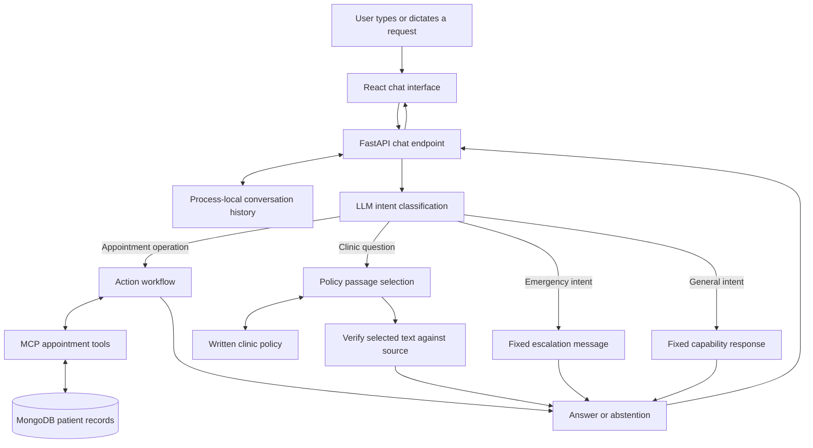
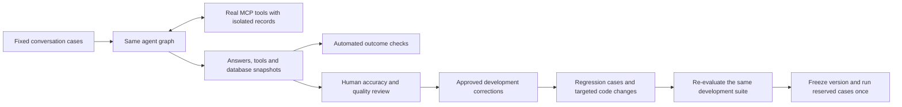

# MedBot: A Clinic Administration Assistant with Source-Grounded Policy Answers and Agent Evaluation

**Technical implementation report — IEEE-style organization**

**Scope:** application design, implementation methods, experimental evaluation and reproducibility.

**Evidence basis:** repository source and saved evaluation artifacts; no new service calls or experiments were performed for this report.

## Abstract

MedBot is a conversational clinic administration prototype that accepts appointment requests and questions about a fictional clinic. A React interface sends text, including browser-transcribed speech, to a FastAPI application. A LangGraph workflow classifies each request and selects appointment handling, policy answering, a fixed emergency escalation message, or a general capability response. Appointment operations are exposed through Model Context Protocol (MCP) tools backed by MongoDB. In the evaluated version, policy answers display model-selected passages only after checking that they occur in the written clinic policy; unsupported selections produce an abstention. An evaluation framework separates intent classification, tool execution, database outcomes, human-rated accuracy, unsupported claims and response quality. Human-reviewed corrections improved development conversations passing automated checks from 34/40 to 39/40. A frozen, reserved set of 12 conversations passed all applicable automated checks and received 12 reviewer pass labels, with mean quality 4.75/5 and three documented completeness omissions. These are prototype measurements using a real model and isolated mock database records, not evidence of clinical deployment or measured staff savings. The project demonstrates agent evaluation and a reviewed improvement loop, rather than custom LLM training or routing between different models.

**Index Terms—** Conversational agents, clinic administration, LangGraph, tool calling, MCP, source grounding, MongoDB, agent evaluation, regression testing.

## I. Introduction

Clinic reception combines repetitive information requests with operations that must actually change a record. A conversational answer is insufficient when a patient asks to cancel an appointment: the system must identify the relevant record, perform the operation and distinguish success from failure. Likewise, a fluent answer about clinic services is misleading when the written policy does not document those services.

MedBot explores this problem by separating conversation, workflow selection, controlled database operations and evaluation. Its intended operational benefit is to handle routine requests consistently so reception staff can focus on exceptions requiring human attention. Staff workload reduction, shorter waiting times, patient satisfaction and health outcomes have not been measured. The demonstrated impact is an improvement in the defined development workflow checks and reviewed answer quality.

This report uses IEEE-style sections, an abstract, methods, results, limitations and source references. It is not a claim of IEEE certification, publication, healthcare compliance or clinical validation.

### A. Version and working-tree status

The experimental results describe the frozen `reviewed-v3-confirmed` application and its `frozen-v3-holdout` evaluation. Application and dataset hashes are recorded in `eval/reviewed_summary.json`, `eval/holdout_summary.json` and `eval/holdout_manifest.json`.

At this documentation inspection, the working tree contains unresolved Git conflict markers in `README.md`, `backend/med_agents.py` and `backend/tests/integration/test_api.py`. The conflicted agent file contains competing legacy and evaluated implementations. Consequently, the current checkout cannot be described as a runnable, verified release. Historical passing tests and model results do not validate a file containing conflict markers.

The report identifies the evaluated behavior separately from integration changes visible in the checkout. Documentation work did not resolve the Git operation, alter model prompts, rerun evaluations or change the recorded results.

## II. Application Scope and Functional Contract

### A. Intended users and boundaries

The primary interaction is a patient or visitor asking a receptionist-style question. Clinic administrative staff are the intended operational stakeholders. Engineers and reviewers use the evaluation tools to inspect whether the assistant follows the clinic reference and completes the requested operation.

The implemented demonstration uses fictional policies and synthetic records. It is an administrative workflow, not a diagnostic system, prescribing system, electronic health record integration or clinically validated triage service.

### B. Inputs

The application accepts a natural-language message through `POST /chat`, with an optional session identifier. Users may provide patient ID, name, desired date and time, visit reason, or a follow-up to an earlier turn. Browser speech recognition can populate the same text input; the backend does not receive an audio file through this interface.

Additional system inputs are the clinic policy file, previously stored conversation turns, model configuration and appointment records. The runtime reference is `backend/data/clinic_policies.md`. PDFs remain in the data directory but are not additional policy sources in the evaluated version. The application has no patient document-upload workflow or vector-search index.

### C. Outputs

The HTTP response contains the assistant text, session identifier, selected intent and workflow-step strings. Depending on the request, the text is a clarification, a policy passage, an explicit statement that information is unspecified, an appointment result, a general capability message or an emergency-services advisory.

Appointment requests also have a database outcome. The text and record change are distinct outputs: a confirmation sentence alone does not establish that an appointment was booked. The evaluator therefore records tool arguments/results and database snapshots in addition to conversational replies.

The emergency branch displays advice to contact emergency services; it does not call emergency services, dispatch assistance or notify clinic staff automatically.

## III. System Architecture



**Figure 1. Logical application architecture.** Triage, policy passage selection and action reasoning use the same configured model through LiteLLM. Branch selection is agent/workflow routing, not selection among specialized models. The MCP transport is a separate implementation choice described below.

FastAPI owns the request boundary and session lookup. LangGraph makes the branching structure explicit. MCP exposes named operations instead of allowing the model to generate arbitrary database commands. MongoDB stores the records. React renders messages, activity indicators and voice-related controls. The evaluation layer exercises the graph and tools while independently checking outcomes.

## IV. Frontend and Request Lifecycle

### A. Interface composition

`frontend/src/App.tsx` coordinates the chat window, information panel and voice visualizer. Shared React state tracks whether the application is idle, classifying a request, handling policy, performing an action or displaying emergency escalation. GSAP animates panels and transitions; Tailwind/CSS provide visual styling. These choices affect interaction and presentation, not answer correctness.

`ChatWindow.tsx` stores the visible message list and input state, provides quick prompts and prevents duplicate submissions while its current request is loading. `ReactMarkdown` renders assistant messages. This browser message list is separate from the server's conversation memory and is not a durable transcript service.

### B. Voice input and output

The microphone control uses browser `SpeechRecognition` or `webkitSpeechRecognition`, configured for English with interim transcripts. Speech is converted into text in the input field. Stopping recording through the control submits available text; browser termination of recognition resets the listening state. Support depends on the browser and its speech service. This is not a custom speech model, and processing cannot be assumed to remain entirely on the user's device.

Responses can be read aloud through browser `speechSynthesis`. `VoiceVisualizer.tsx` displays listening and speaking state; it is not a speech inference backend.

### C. API communication

`frontend/src/api.ts` sends the message and module-scoped current session ID to `/chat`. It uses `VITE_API_URL` when supplied, localhost port 8001 for development by default, and the current origin in production. The fetch timeout is 60 seconds. The session ID is retained in JavaScript memory across turns, not persisted as an authenticated browser account.

Backend intent drives the displayed state. A keyword-based frontend fallback selects an indicator if the intent is missing; it does not replace backend classification or enforce emergency routing. Workflow steps arrive with the final HTTP response. The interface is not streaming intermediate server events or exposing a model's internal reasoning.

The current frontend reports connectivity failure rather than fabricating a successful clinic answer. Its wording that no request completed is stronger than a timeout can establish: the server may have executed a write before the client lost the response. Idempotent retry handling is not implemented.

### D. Static information panel

`InfoPanel.tsx` contains activity, overview, policy and contact tabs. The policy/contact tab content is hardcoded and separate from `clinic_policies.md`. It includes discrepancies, such as an additional insurance provider and generalized fasting advice, and contact/hours values not established by the backend reference. These static UI texts were not validated by the graph benchmark. They must not be mistaken for synchronized clinic policy or measured agent output.

## V. API, State and Conversation Memory

`backend/main.py` defines a FastAPI application and Pydantic request/response models. It generates a UUID when the request has no session ID, retrieves prior turns and builds the graph input. The historical field name `email_content` carries the current chat message; there is no email ingestion service.

The graph state contains the ticket/session identifier, current text, plain user/assistant history, classified intent, extracted identity hints, final answer, workflow steps and structured tool events. A LangGraph message accumulator is declared, but the operational conversation memory is the explicit `chat_history` list.

The process-local `SESSION_STORE` is updated with the user and assistant turns after a successful invocation. Triage receives the latest six history entries, whereas action and policy processing can receive the available full history. This supports follow-ups without treating each message as an isolated request.

The design is easy to inspect and adequate for a single-process demonstration. Memory disappears on restart, is not shared across workers, has no implemented retention policy and is not tied to authenticated ownership. Concurrent requests for one session can race because there is no per-session transactional update.

The current API variant raises a generic HTTP 503 when graph processing throws an exception. That behavior is a later integration change relative to the recorded graph benchmarks. CORS is permissive: adding `FRONTEND_URL` does not remove the wildcard. This is not an authorization mechanism.

## VI. Agent Methods and Control Flow

### A. Intent classification

The triage node sends the current request and recent conversation context to the model and requests JSON containing an intent and identity hints. Allowed intended labels are `action`, `policy`, `emergency` and `general`. Explicit prompt definitions distinguish a request to change an appointment from a question about clinic rules or missing service information.

JSON parsing provides a machine-readable handoff to the graph. A parsing failure falls back to a general intent. This is not equivalent to a validated classifier schema or a fail-safe emergency detector. The routing function maps recognized labels to their branch and sends other values to policy handling.

Using an explicit state graph makes execution paths inspectable and separately testable. It does not make the LLM's classification deterministic or guarantee the correct branch.

### B. Policy passage selection and source verification

The evaluated implementation loads and caches the written policy once per process. A policy question is sent with that reference and conversation context. The model is instructed to return JSON containing exact policy quotations rather than a freely generated clinic answer.

`grounded_policy_answer` parses the result, normalizes whitespace and checks each nonempty quotation against the normalized source text. It removes duplicate selections and returns verified text with a short introduction. Empty selections, fabricated quotations or invalid structures cause an explicit abstention referring the user to clinic staff. An undocumented service is treated as unspecified, not automatically unavailable.

This method was selected because prompt-only instructions still permitted invented staff languages and services in development. Exact source membership is a deterministic check that a fluency-based judge cannot provide. The tradeoff is extractive phrasing and possible omission of relevant passages. A quotation can be authentic but irrelevant or incomplete; human answer review remains necessary. No embedding model, vector database, retrieval ranking or conventional RAG pipeline is used here.

### C. Appointment reasoning and tool loop

The action branch obtains MCP tool descriptions and input schemas and supplies them to the configured model as function definitions. Previous conversation turns and triage identity hints provide context. The model can ask for missing details or propose a named tool call with JSON arguments.

The evaluated workflow permits up to five model/tool rounds. After each proposed call, arguments are parsed, eligible scheduling requests are checked, the tool is invoked and its result is appended as a tool message. Subsequent rounds can complete an operation after an initial lookup. A natural-language response ends the loop. Exhausting the round budget returns an incomplete-processing message rather than an unconditional success claim.

The loop addresses an earlier implementation that handled only one batch of calls and then requested a final answer without tools. That approach could not reliably perform a lookup followed by an update. The bound limits repeated processing but does not provide transactional rollback across several tool calls.

### D. Confirmation of scheduling inputs

Before booking or rescheduling, `unconfirmed_schedule_fields` checks proposed identity, date and time against user messages. Assistant messages are excluded so a previous invented value cannot serve as confirmation. The check requires a supplied ISO date and matches parsed AM/PM or 24-hour times. Missing or ambiguous details produce a request for confirmation without executing that scheduling call.

This is a provenance check, introduced after an observed invented-date/time booking. It is deliberately conservative: relative or differently expressed dates may need clarification. It does not prove identity, fully validate calendar feasibility, resolve contradictory instructions or verify every proposed field. It is not applied as an equivalent identity guard to every cancellation or registration call.

### E. Emergency and general responses

After an emergency classification, the emergency node returns a fixed US-oriented emergency-services/ER advisory with no further model generation or appointment tool call. Classification itself still requires the external model first. Therefore emergency behavior depends on model availability, latency and classification correctness; it is not a pre-model keyword safety filter.

The evaluated general branch uses a fixed description of available administrative capabilities. This avoids inventing clinic facilities while answering a broad capability question. It can be less natural for greetings, thanks or farewells because those share the same general branch.

## VII. MCP Tools and Data Model

MCP separates model proposals from executable, named Python operations. FastMCP derives tool descriptions and schemas from the tool definitions. The model is not given raw MongoDB access. This separation improves inspectability and test substitution; MCP alone does not supply patient authentication, ownership checks or healthcare compliance.

| Tool | Database behavior | Important semantics |
| --- | --- | --- |
| `get_patient_details` | Lookup by patient ID | Returns a string representation or not-found text |
| `book_appointment` | Update/upsert patient appointment | Can create a patient; replaces that record's appointment fields |
| `cancel_appointment` | Set appointment status to Cancelled | Does not delete the patient |
| `reschedule_appointment` | Update date/time and Scheduled status | Preserves the existing reason unless another operation changes it |
| `register_patient` | Insert if patient ID is absent | Initializes an empty appointment and optional contact fields |

Each patient document contains identity/contact fields and one embedded appointment with status, date, time and reason. Dates/times are stored as strings. There is no implemented appointment-history collection, clinician calendar, slot inventory, conflict detection, billing processor, pharmacy system or automatic insurance-benefit verification.

Tools return text messages; an MCP error flag and a business-level failure message are not identical. For example, an update with no modified document can return failure text without a protocol error. Repeating an already-applied update may also report no modification. This motivates inspecting records instead of relying solely on a tool name or confirmation sentence.

The current `med_mcp.py` uses lazy collection initialization: importing tools does not immediately connect to MongoDB; the first actual operation initializes `medibot_db.patients`. Tests can inject a mock collection. `certifi` supplies CA certificates to the client. Credentials remain environment settings, not model-generated connection instructions.

### A. Transport variants and integration boundary

The evaluated application snapshot uses an absolute-path stdio MCP server process through `open_tool_session`. Evaluations replace that session with a FastMCP in-process client while executing the same tool implementations against mock collections.

The conflicting legacy branch proposes an in-process application client to avoid starting a Python subprocess per request on a small host. That is a plausible resource tradeoff, but the two variants are not yet resolved in the checkout. Preserving the evaluated grounding and scheduling protections while choosing a transport requires an explicit completed integration; the historical scores do not prove that integration has passed.

The current evaluator also calls `med_mcp.client.close()` unconditionally. With the newly lazy client initialized to `None`, that line is an integration incompatibility unless guarded or adapted. This report records the mismatch rather than silently treating the current runner as verified.

## VIII. Model Gateway and Configuration

The evaluated `_nim_options` function supplies the configured model, NVIDIA-compatible API base, API key, a 512-token output budget and a thinking-related request option. The default model identifier is `openai/nvidia/nemotron-3.5-lightning-30b-a3b`; the provider-compatible prefix is a LiteLLM routing convention, not evidence of multiple application models.

`NVIDIA_API_KEY` is required. `LITELLM_MODEL` and `NVIDIA_API_BASE` can override the defaults. `MONGODB_URI` supplies the appointment store, `FRONTEND_URL` affects CORS configuration and `VITE_API_URL` affects the frontend build. Production settings belong in the host environment. The MCP module and evaluator load dotenv settings; the API/agent import path does not itself guarantee loading `backend/.env`, so local execution must supply its environment appropriately.

Application-level LiteLLM settings request retries and a timeout. Evaluation overrides retries to zero and uses a request timeout so outages do not silently multiply benchmark spending. Frontend timeout, model-call timeout and an entire multi-round action have different scopes: a complete operation can outlast the browser's timeout.

No weights are trained or fine-tuned. No model registry, self-hosted LLM inference endpoint, learned task-to-model selector or automatic model update is implemented.

## IX. Evaluation Design



**Figure 2. Evaluation and reviewed improvement loop.** The reserved cases do not feed prompt tuning or regression promotion after their final execution.

### A. Suites and execution environment

`eval/development.json` contains 40 conversations and 41 user turns spanning policy facts, unsupported questions, missing details, appointment operations, emergency examples and general interaction. `build_development.py` reproduces this development dataset without reading the reserved questions.

The user-authored holdout contains 12 conversations and 14 turns: three policy cases, three appointment cases, two missing-detail cases, two undocumented-policy cases and two emergency cases. `eval/holdout.json` preserves the conversation wording. The manifest records source/dataset hashes, fixture choices and the accepted alternative labels for unsupported questions.

The runs use real external model calls and the full LangGraph workflow. Real MCP tools execute through an in-process protocol client with a fresh mongomock collection per case. Synthetic seed records support cancellation/rescheduling; an unrelated sentinel record makes accidental collateral changes visible. This is not a benchmark of Atlas connectivity, deployed HTTP behavior, browser voice support or stdio-process reliability.

### B. Automated measurements

Intent accuracy counts accepted labels over completed user turns. Workflow checks inspect required tools, every specified appointment field, unchanged unrelated records, absence of premature operations, nonempty responses and expected emergency wording. The pass rate is the fraction of conversations satisfying all applicable deterministic checks.

Policy checks do not establish whether an answer includes every required fact. Likewise, a response can pass intent and no-mutation checks while containing an unsupported claim. Automated pass rate must not be relabeled as overall factual accuracy.

The runner saves model identity, source/dataset/policy hashes, timings, available token usage, per-case outcomes and database snapshots. Files use new run identifiers and atomic saves. Live execution requires `--live`; dataset validation alone does not call a model. Requests are paced, and an operational failure stops the run. Continuations preserve previous artifacts and carry completed cases forward when the configured application and references match.

### C. Human evaluation and optional model judging

Human review records accuracy as pass/partial/fail, whether a response contains an unsupported claim, quality from 1 to 5, notes and proposed corrections. Quality concerns relevance, completeness and clarity. Reported human pass fractions count pass labels; they do not assign a hidden fractional score to partial answers.

The response-level unsupported-claim measure counts reviewed answers with invented/contradictory facts or unsupported operation confirmations. Its denominator is the reviewed sample, not all future users. The same 12 selected development conversations were reviewed before and after changes; this was a purposeful sample, not random sampling or independent adjudication.

An optional source-grounded model judge is implemented but disabled in the recorded runs. It uses the configured model, so it is not an independent second-model audit. Invalid judge outputs remain errors, not zero-quality answers. Human review itself is fallible: the D21 availability-check promise was marked unsupported-claim-free despite the absence of an availability tool. That disagreement is explicitly retained.

## X. Experimental Results

| Measurement | Baseline development | Revised development | Reserved final set |
| --- | --- | --- | --- |
| Conversations completed | 40/40 across continuations | 40/40 | 12/12 |
| Accepted intents | 38/41, 92.7% | 41/41, 100% | 14/14, 100% |
| Automated conversation passes | 34/40, 85.0% | 39/40, 97.5% | 12/12, 100% |
| Human-reviewed cases | 12 selected cases | Same 12 cases | All 12 cases |
| Human accuracy labels | 6 pass, 4 partial, 2 fail | 10 pass, 2 partial | 12 pass |
| Human mean quality | 3.58/5 | 4.75/5 | 4.75/5 |
| Human unsupported-claim labels | 4/12 | 0/12, with D21 disagreement | 0/12 |

Development automated passes improved by **12.5 percentage points**, or five additional passing conversations. The change followed reviewed corrections to policy grounding, classification definitions and action handling. Intermediate experiments exposed limitations of prompt-only changes and an invented-date/time write; source verification and scheduling confirmation were introduced in response. These are development interventions, not independently isolated causal ablations.

The revised development version still omitted the walk-in triage detail in D03 and unnecessarily requested a patient name instead of rescheduling in D29. A different holdout rescheduling conversation succeeded; that does not erase the development failure or establish consistent success across all phrasings.

All holdout cases received human pass labels, but notes identified three omissions: the uninsured starting price, general refill processing time and cancellation-notice policy. Retaining these notes matters because the rating scheme tolerated some omissions as reduced quality rather than failed accuracy. The result must not be described as universally perfect answers or zero real-world hallucinations.

The baseline stopped once on a provider rate limit and once on the evaluator's handling of an empty model response, then completed through preserved continuations. Later artifacts distinguish those attempts from answer-quality scores. Median elapsed case time was approximately 3.45 seconds for baseline development, 5.94 seconds for revised development and 5.82 seconds for holdout. These values include workflow overhead and intentional request pacing; they are not clean inference-latency comparisons or a production SLA. No monetary savings/cost claim is derived from them.

A recorded set of **71 offline evaluator, tool, routing, API and session checks passed during implementation**. This is historical verification of that version, not a fresh run against the currently conflicted checkout. An older hosted smoke report recorded two successful synthetic responses and one failed action clarification before a transport change. It does not verify the latest release or current hosted booking behavior.

## XI. Human-Reviewed Continuous Improvement

The implemented loop is: save actual outputs; obtain reference-based human ratings; record an approved correction; promote the development case with correction provenance; make a targeted engineering change; and compare versions on the same dataset and policy. `eval/improve.py` preserves provenance, rejects overwriting an existing regression dataset and reports improvements alongside regressions.

This demonstrates an operational feedback and regression process. A human engineer changes prompts or workflow code; the system does not update its weights, retrain itself, automatically accept user assertions as truth or autonomously deploy a new version. Holdout results are retained for final reporting instead of being recycled into tuning while still called unseen.

## XII. Repository Organization and Maintenance Map

```text
medibot/
├── README.md                   Project entry point
├── Dockerfile                  Frontend build and Python/API image
├── backend/
│   ├── main.py                 HTTP contract, session state, static UI hosting
│   ├── med_agents.py           Graph, model gateway, grounding and action workflow
│   ├── med_mcp.py              Tool definitions and MongoDB access
│   ├── setup_mongo.py          Destructive demo-data seeding utility
│   ├── requirements.txt        Backend dependencies
│   ├── pytest.ini              Default exclusion of marked external E2E cases
│   ├── data/                   Written policy plus historical example PDFs
│   └── tests/
│       ├── unit/               Tools, paths and routing checks
│       ├── integration/        API, sessions and transport checks
│       ├── e2e/                Legacy external-service conversations
│       └── performance/        Concurrency and timing checks
├── frontend/
│   ├── src/App.tsx             Shared UI state and layout
│   ├── src/ChatWindow.tsx      Messages, input, speech recognition/synthesis
│   ├── src/api.ts              HTTP client and current session ID
│   ├── src/InfoPanel.tsx       Activity and hardcoded information tabs
│   ├── src/VoiceVisualizer.tsx Listening/speaking presentation
│   ├── src/types.ts            UI state/message types and labels
│   ├── src/main.tsx            React entry point
│   └── package.json            Frontend dependencies and build commands
├── eval/
│   ├── run.py                  Unified runner, scoring and human-review merge
│   ├── improve.py              Approved regression promotion and comparison
│   ├── build_development.py    Development dataset construction
│   ├── development.json        Fixed 40-conversation development suite
│   ├── holdout.json            Reserved conversations in executable form
│   ├── *_summary.json          Sanitized historical measurements
│   ├── holdout_manifest.json   Dataset/source/fixture provenance
│   ├── human_review_comparison.json  Ratings and reviewer disagreement
│   ├── test_evaluator.py       Evaluator correctness/isolation checks
│   ├── RESULTS.md              Detailed measured results and limits
│   └── README.md               Evaluation operating guide
├── docs/
│   ├── IEEE_EVALUATION_REPORT.md  Peer-reviewed evaluation report & metrics
│   ├── IEEE_DOCUMENTATION.md      Comprehensive architecture report
│   ├── medibot_holdout.md         Original user-authored final conversations
│   ├── RESUME_EVIDENCE.md         Résumé evidence and verification
│   └── hosted_smoke_2026-10-22.json
└── .local/                    Ignored résumé points, reviews and frozen sources
```

Historical evaluation scripts remain for provenance. The unified `eval/` framework is the relevant source for the reported development and holdout measurements. Older résumé evidence describes an earlier version; it must not supersede newer measured results or be combined with them as one experiment.

For future changes, HTTP/session behavior belongs in `main.py`, agent behavior in `med_agents.py`, record operations in `med_mcp.py`, interface behavior under `frontend/src/`, and scoring/feedback rules under `eval/`. A change to the written policy changes the reference task and must be reflected in dataset/version provenance. The policy cache also requires process restart or explicit invalidation to reflect a changed file.

## XIII. Deployment and Integration Considerations

The Dockerfile builds React with Node 22, then creates a Python 3.11 runtime containing the backend and built frontend. Uvicorn serves `main:app` on port 8001; FastAPI mounts assets and serves the React entry point when the build directory exists. The command uses a fixed port rather than dynamically reading a host-provided port. Backend dependency versions are not pinned, so reproducing a future environment requires more than copying the current dependency names.

Hosting this application does not host the LLM. The server needs the configured external model API and, for real appointment operations, MongoDB connectivity. The evaluated mock records establish neither Atlas availability nor cloud credentials/permissions. In-memory conversation state also does not survive host replacement or support shared multi-worker memory.

`setup_mongo.py` drops the patients collection before inserting demo data. It is a destructive setup utility, not a migration or a routine application startup step. It was not run for documentation work.

The current integration blockers are the unresolved conflicts and the evaluator/lazy-client mismatch described in Sections I and VII. The conflicting README cannot serve as a clean release guide until resolved. Static UI policy discrepancies, missing authenticated patient ownership, retry ambiguity and permissive CORS also prevent treating this as a hardened clinic service. These observations are documented current limits, not newly implemented features or claims that a healthcare deployment is ready.

## XIV. Conclusions

MedBot combines a conversational interface, explicit workflow orchestration, source-checked policy answers and named appointment tools. Its central engineering contribution is a system that evaluates what an agent actually does: which intent it selects, which tools it invokes, how records change, what unsupported claims it makes and how people rate its answers. A reviewed correction/regression cycle produced measurable development improvements, followed by a separate frozen final evaluation.

The project can credibly demonstrate **agent evaluation and human-reviewed continuous improvement**. It does not demonstrate custom LLM training/deployment, multi-model task routing, measured clinic productivity gains or clinical safety. The evaluated version and the currently conflicted integration state must remain distinguishable when presenting or reproducing the work.

## References

[1] Application implementation: [`backend/main.py`](backend/main.py), [`backend/med_agents.py`](backend/med_agents.py), [`backend/med_mcp.py`](backend/med_mcp.py). Current conflict status is described above; frozen-version hashes are recorded in the evaluation artifacts.

[2] Interface implementation: [`frontend/src/`](frontend/src/), [`frontend/package.json`](frontend/package.json).

[3] Fictional reference policy: [`backend/data/clinic_policies.md`](backend/data/clinic_policies.md).

[4] Evaluation protocol and measurements: [`eval/README.md`](eval/README.md), [`eval/RESULTS.md`](eval/RESULTS.md), [`eval/human_review_comparison.json`](eval/human_review_comparison.json).

[5] Frozen final evaluation provenance: [`eval/holdout_manifest.json`](eval/holdout_manifest.json), [`eval/holdout_summary.json`](eval/holdout_summary.json), [`docs/medibot_holdout.md`](medibot_holdout.md).

[6] Earlier hosted observations: [`docs/hosted_smoke_2026-10-22.json`](docs/hosted_smoke_2026-10-22.json). These observations are historical and are not a current deployment verification.
